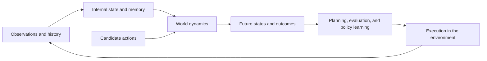
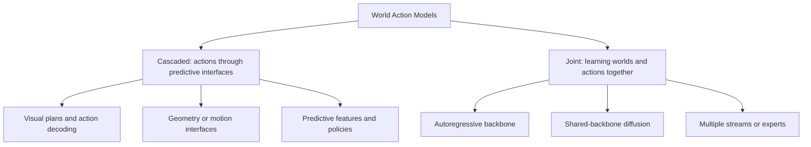
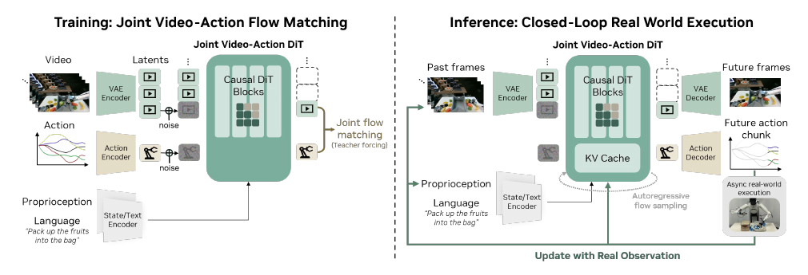
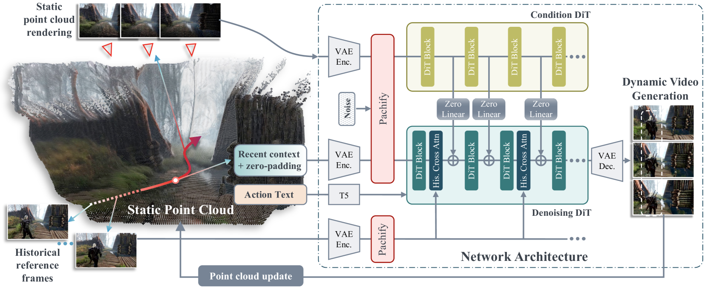
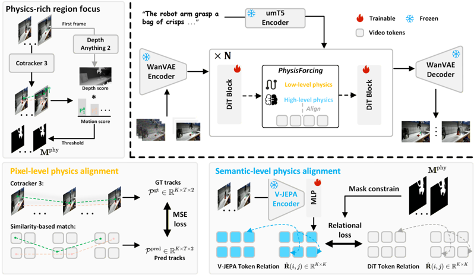
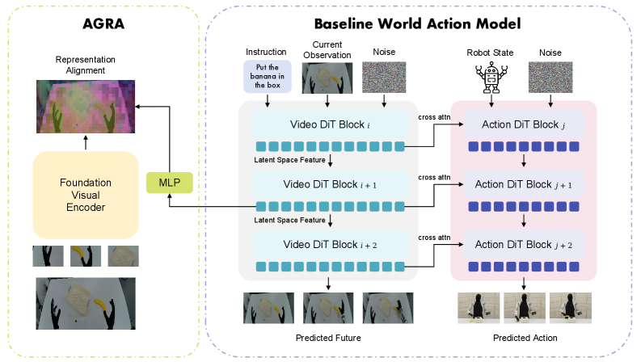

# Awesome World Model

**English** | [简体中文](README_cn.md)

> **World models: from environment representations and future prediction to embodied action.**
>
> Represent the current state, predict action consequences, and use imagined futures to guide decisions in the real world.

World models learn internal representations of environments and how those environments change, connecting visual understanding, video generation, model-based reinforcement learning, and robot control. For embodied intelligence, three questions become central: **what should a model predict, how should predictions inform actions, and how can predictions remain reliable over long interactions?**

[Paper index](docs/paper-index.md) · [World model foundations](docs/01-world-model-primer.md) · [World Action Models](docs/02-world-action-models.md) · [Research problems and methods](docs/03-problem-taxonomy.md)

## Contents

- [1. World model primer](#primer)
- [2. World Action Models: from prediction to action](#wam)
- [3. Research problems and representative methods](#problems)
- [4. Benchmarks and experimental results](#evaluation)
- [5. Open questions](#discussion)
- [6. Papers and learning resources](#resources)

## 1. World model primer

### 1.1 State representations and dynamics

Consider a robot pushing a cup across a table. The current image shows the cup's appearance and location, but its velocity, contact state, and occluded parts may require a history of observations. A world model first forms an internal state, then predicts how candidate actions will change the cup and its surroundings.

$$
z_t = E(o_{\le t},a_{\lt t}),\qquad
\hat z_{t+1} \sim p_\theta(z_{t+1}\mid z_t,a_t).
$$

Here, $o_t$ denotes an observation, $z_t$ an internal state, and $a_t$ an action. States may contain latent features, objects, 3D structure, or memory. Predicted states can be decoded into images and video, or used directly for planning and policy learning. [World Models](https://arxiv.org/abs/1803.10122) combines visual compression, temporal dynamics, and control; [Dreamer](https://arxiv.org/abs/1912.01603) learns policies and value functions from imagined trajectories in latent space.

World models can inform decisions at several stages: generating imagined training trajectories, comparing candidate actions at inference, or providing predictive features to an action model. The prediction horizon, state representation, and downstream use determine which aspects of the environment the model needs to learn.

### 1.2 From latent dynamics to interactive worlds

| Date | Work | Main contribution |
|---|---|---|
| 2018-03-27 | [World Models](https://arxiv.org/abs/1803.10122) | Combines visual compression and temporal dynamics, including control learned in an imagined environment |
| 2019-12-03 | [Dreamer](https://arxiv.org/abs/1912.01603) | Learns policies and value functions through latent imagination |
| 2023-01-10 | [DreamerV3](https://arxiv.org/abs/2301.04104) | Learns world models and behaviors across diverse tasks with a unified configuration |
| 2023-01-19 | [I-JEPA](https://arxiv.org/abs/2301.08243) | Learns visual features by predicting representations of image regions |
| 2024-08-27 | [GameNGen](https://arxiv.org/abs/2408.14837) | Simulates interactive DOOM dynamics through action-conditioned video generation |
| 2025-06-11 | [V-JEPA 2](https://arxiv.org/abs/2506.09985) | Connects video representation learning, future prediction, and robot planning |

These methods develop different prediction targets: Dreamer learns latent dynamics, I-JEPA predicts image-region representations, and GameNGen generates subsequent frames conditioned on actions. I-JEPA provides a visual representation learning method; temporal and action conditioning extend prediction to interactions and their consequences.

Video generation broadens the scenes and changes that world models can represent. [Sora](https://openai.com/index/video-generation-models-as-world-simulators/) explores simulation through video models, while [Genie 3](https://deepmind.google/blog/genie-3-a-new-frontier-for-world-models/) targets interactive world generation. Control additionally requires persistent state and accurate responses to specific actions.

### 1.3 Applications

| Application | Modeled state and interaction | Representative work |
|---|---|---|
| Games and interactive environments | Scene and character changes caused by control inputs | [GameNGen](https://arxiv.org/abs/2408.14837) |
| Robot manipulation | Object motion, contact, visual plans, and robot actions | [World Action Models](https://arxiv.org/abs/2605.12090) |
| Driving and traffic | Road participants, trajectories, and driving outcomes | [WorldSimBench](https://arxiv.org/abs/2410.18072) |
| Social simulation | Individual memory, plans, and multi-agent interactions | [Generative Agents](https://arxiv.org/abs/2304.03442) |
| Web agents | Webpage states and the consequences of candidate operations | [WebDreamer](https://arxiv.org/abs/2411.06559) |

State and action have different meanings across these applications. Robot manipulation places particular demands on object geometry, contact dynamics, and embodiment constraints: world predictions must ultimately connect to executable control.

## 2. World Action Models: from prediction to action

### 2.1 Connecting world models and action models

World Action Models (WAMs) combine predictive world modeling with action generation. A VLA policy outputs actions from observations and instructions; an action-conditioned world model predicts the consequences of specified actions; goal-conditioned visual planning generates future states associated with a task. [World Action Models: The Next Frontier in Embodied AI](https://arxiv.org/abs/2605.12090)

| Model | Formulation | Role |
|---|---|---|
| VLA policy | $p(a\mid o,\ell)$ | Generates actions from observations and instructions |
| Action-conditioned world model | $p(o'\mid o,a)$ | Predicts future observations caused by a given action |
| Goal-conditioned visual planning | $p(o'\mid o,\ell)$ | Generates visual plans or subgoals for a task |
| Cascaded WAM | $p(o'\mid o,\ell)\,p(a\mid o',o,\ell)$ | Predicts a future, then extracts actions from it |
| Joint WAM | $p(o',a\mid o,\ell)$ | Learns future observations and actions together |

Here, $o$ is the current observation, $o'$ a future observation, $a$ an action, and $\ell$ a language instruction. History and proprioception can provide additional context. Futures can also take the form of latent features or motion trajectories without requiring full RGB video generation.

### 2.2 What should a model predict?

| Prediction target | Role in action generation | Representative work |
|---|---|---|
| Video, keyframes, and visual subgoals | Specifies desired states and decomposes long tasks | [UniPi](https://arxiv.org/abs/2302.00111), [VLP](https://arxiv.org/abs/2310.10625), [RoboEnvision](https://arxiv.org/abs/2506.22007) |
| Predictive features and future latents | Provides dynamics information with less pixel reconstruction | [VPP](https://arxiv.org/abs/2412.14803), [FLARE](https://arxiv.org/abs/2505.15659), [LaWAM](https://arxiv.org/abs/2606.15768) |
| Geometry, flow, and object trajectories | Describes where objects are and how they should move | [Im2Flow2Act](https://arxiv.org/abs/2407.15208), [3DFlowAction](https://arxiv.org/abs/2506.06199), [RynnWorld-4D](https://arxiv.org/abs/2607.06559) |
| Tactile and contact states | Captures physical interactions that are difficult to observe visually | [Dream-Tac](https://arxiv.org/abs/2606.08737), [N₀-TWAM](https://arxiv.org/abs/2607.23783) |
| Value, progress, and outcomes | Evaluates candidate actions, detects deviations, and supports recovery | [Cosmos Policy](https://arxiv.org/abs/2601.16163), [τ₀-WM](https://arxiv.org/abs/2606.01027), [MV-WAM](https://arxiv.org/abs/2606.21088) |

Prediction targets determine the information available to the action model. Object trajectories express intended motion, touch describes contact, and latent features reduce the burden of full video generation. Their usefulness for grasping, transport, placement, and precise insertion depends on the geometry and dynamics each task requires.

### 2.3 Cascaded and joint architectures

| Architecture | Connection between prediction and action | Representative work |
|---|---|---|
| Cascaded: visual planning | Generates future frames, then decodes actions with an inverse dynamics model or policy | [UniPi](https://arxiv.org/abs/2302.00111), [VLP](https://arxiv.org/abs/2310.10625), [MVA](https://arxiv.org/abs/2607.19343) |
| Cascaded: geometry and motion | Predicts object motion, followed by learned control, kinematics, or trajectory optimization | [AVDC](https://arxiv.org/abs/2310.08576), [Im2Flow2Act](https://arxiv.org/abs/2407.15208), [Dream2Flow](https://arxiv.org/abs/2512.24766) |
| Cascaded: predictive features | Conditions an action model on future latents or predictive intermediate features | [ARDuP](https://arxiv.org/abs/2406.13301), [VPP](https://arxiv.org/abs/2412.14803), [RynnWorld-4D](https://arxiv.org/abs/2607.06559) |
| Joint: autoregressive backbone | Shares a multimodal sequence model across world prediction and action generation | [WorldVLA](https://arxiv.org/abs/2506.21539), [RynnVLA-002](https://arxiv.org/abs/2511.17502) |
| Joint: shared-backbone diffusion | Learns future and action objectives in a shared model | [UWM](https://arxiv.org/abs/2504.02792), [FLARE](https://arxiv.org/abs/2505.15659), [DreamZero](https://arxiv.org/abs/2602.15922) |
| Joint: multiple streams or experts | Maintains modality-specific branches with cross-branch interaction | [Motus](https://arxiv.org/abs/2512.13030), [LingBot-VA](https://arxiv.org/abs/2601.21998), [Fast-WAM](https://arxiv.org/abs/2603.16666) |

**Visual plans and motion interfaces.** UniPi expresses tasks through visual futures and infers actions with inverse dynamics. Im2Flow2Act passes object motion trajectories to a learned control policy, while Dream2Flow recovers 3D object flow from generated video and optimizes robot actions. These interfaces expose the plan, while requiring a mapping from visual objectives to robot motion, grasping, and contact.

**Predictive features and action policies.** VPP extracts predictive visual features from intermediate layers of a video model. RynnWorld-4D transfers dynamics learned through RGB, depth, and flow modeling to a policy. Without full video decoding, the action model must still recover object changes, spatial relationships, and interaction information from these features.

**Joint world and action generation.** WorldVLA shares a backbone between action and world-prediction modes. UWM supports policy, forward-dynamics, and inverse-dynamics tasks by changing which modalities are conditioned on or generated. DreamZero uses joint video-action flow matching and updates its generation context with real observations during execution. Joint training can share dynamics information, while the deployment procedure depends on the model.

*Figure: [DreamZero](https://arxiv.org/abs/2602.15922). Future video and actions are trained jointly; real observations update the context during execution.*

### 2.4 Prediction during training and deployment

| Work | Role of future information during training | Information used at deployment |
|---|---|---|
| [WorldVLA](https://arxiv.org/abs/2506.21539) | Shares a backbone for action generation and world prediction | Direct action generation in action mode |
| [Fast-WAM](https://arxiv.org/abs/2603.16666) | Joint future and action learning with restricted information access for the action branch | Current-frame world features and the action branch; the future branch is removed |
| [LaWAM](https://arxiv.org/abs/2606.15768) | Learns latent actions and future-feature prediction | Current features and predicted latent subgoals |
| [DreamZero](https://arxiv.org/abs/2602.15922) | Joint video-action generation | Joint prediction and continually updated real observations |
| [Cosmos Policy](https://arxiv.org/abs/2601.16163) | Encodes actions, states, and values into video latent sequences | Conditional generation for control or planning |

Future supervision can improve action representations during training, while future generation adds computation at deployment. Fast-WAM constrains information access through its attention structure so that the future branch can be removed at inference. LaWAM retains compact future features, and DreamZero generates video and actions jointly. These choices explore different trade-offs between predictive information and inference cost.

[World Action Models: methods and architectures](docs/02-world-action-models.md)

## 3. Research problems and representative methods

Long interactions require a model to preserve past changes, predict the consequences of specific actions, and provide task-relevant information to a policy. Memory, physical dynamics, and action representations jointly affect the reliability of world models for decision-making.

| Research problem | Typical difficulty | Main approaches |
|---|---|---|
| Long-term state consistency | Scenes change on revisits, occluded objects disappear, or task stages are forgotten | Spatial memory, history compression, and object-centric states |
| Action and physical correctness | Predictions ignore actions, trajectories deform, or contact relationships become inconsistent | Fine-grained action alignment, structural supervision, and post-training |
| Representations for action | Plausible predictions leave the policy without critical geometry or focused on irrelevant backgrounds | Latent subgoals and action-relevant feature alignment |

### 3.1 Long-term state consistency

**Spatial and episodic memory.** [Video World Models with Long-term Spatial Memory](https://arxiv.org/abs/2506.05284) stores geometry and historical reference frames online to provide spatial and visual context when revisiting a region. Recent observations describe current changes, while long-term memory preserves information beyond a limited video context.

*Figure: [Video World Models with Long-term Spatial Memory](https://arxiv.org/abs/2506.05284). Spatial memory and historical retrieval support long-term prediction.*

**Compressed history and streaming generation.** [RELIC](https://arxiv.org/abs/2512.04040) compresses history into latent tokens and incorporates action and camera-pose information for causal streaming generation. [DexWorldModel](https://arxiv.org/abs/2604.16484) combines semantic states, TTT Memory, and asynchronous inference to reduce history-dependent storage and sequential computation.

**Object states and multi-stage planning.** [WorldDP](https://arxiv.org/abs/2606.08775) learns dynamics over object-centric states, plans subgoals at a high level, and executes them with a low-level Diffusion Policy. Multi-stage planning relies on correct object states; longer interactions also require persistent object identity, state under occlusion, and completed-task information.

Spatial memory preserves layouts, compression limits history costs, and object representations support planning. Dynamic environments still require deciding when stored states become stale and how contact, movement, and task progress should update memory.

### 3.2 Action and physical correctness

**Fine-grained action conditioning.** [Ctrl-World](https://arxiv.org/abs/2510.10125) combines per-frame action conditioning, multi-view prediction, and history retrieval to support robot interaction and policy evaluation. Temporal alignment between actions and predicted frames determines whether the model can distinguish operations with different directions, magnitudes, and ordering.

**Structural supervision.** [PhysisForcing](https://arxiv.org/abs/2606.28128) constrains local motion through point trajectories and supervises interaction structure through entity relationships, focusing training on object motion and interactions.

*Figure: [PhysisForcing](https://arxiv.org/abs/2606.28128). Local trajectories and entity relationships constrain motion and interaction structure.*

**Post-training.** [EVA](https://arxiv.org/abs/2603.17808) decodes video into actions with an inverse dynamics model and constructs rewards from velocity, acceleration, embodiment limits, and related constraints. [ABot-PhysWorld](https://arxiv.org/abs/2603.23376) evaluates physical plausibility and action consistency separately for preference optimization. Both feed control constraints or physical evaluations back into generation, with results depending on their action decoders, evaluators, and training coverage.

Geometric continuity, contact relationships, and action executability impose different constraints. Changing actions, reversing trajectories, or introducing failed operations tests whether the model predicts the consequences of those interventions.

### 3.3 Representations for action

**Compact future subgoals.** [LaWAM](https://arxiv.org/abs/2606.15768) learns latent actions and future prediction in visual feature space, allowing the action module to read current features and predicted subgoals. Reducing appearance reconstruction must still preserve the geometry and dynamics needed for precise manipulation.

**Aligning world features with action decoding.** [AGRA](https://arxiv.org/abs/2606.12217) studies the connection between video-generation features and action heads. It uses spatial-semantic information from a visual teacher to align intermediate world-model features and improve representations of action-relevant regions.

*Figure: [Making Foresight Actionable](https://arxiv.org/abs/2606.12217). A visual teacher guides spatial-semantic features in the world model for action decoding.*

Prediction for action must retain information that distinguishes the consequences of different operations. The value of object positions, motion directions, and contact states depends on a task's precision, generalization, and latency requirements.

[Research problems, method details, and experimental analysis](docs/03-problem-taxonomy.md)

## 4. Benchmarks and experimental results

### 4.1 What is evaluated?

| Capability | Benchmark or task | Evaluation focus |
|---|---|---|
| Visual quality and control utility | [WorldSimBench](https://arxiv.org/abs/2410.18072) | Perceptual quality and the usefulness of world prediction for decisions |
| Physical prediction | [Physics-IQ](https://arxiv.org/abs/2501.09038) | Correct future evolution in specified physical scenarios |
| Embodied video generation | [EWMBench](https://arxiv.org/abs/2505.09694) | Scene, motion, and semantic quality |
| Video understanding and reasoning | [MMWorld](https://arxiv.org/abs/2406.08407) | Multidisciplinary video question answering and reasoning |
| Robot manipulation | LIBERO, RoboTwin, RoboCasa, and real-robot tasks | Task success, generalization across scenes, and execution stability |

Prediction quality, task success, and runtime efficiency measure different capabilities. Long-term prediction requires tracking state drift; action-conditioned models must respond to changes in control; policies need to demonstrate the benefit of prediction across complete tasks.

### 4.2 Representative experiments

| Work | Experimental setting | Result |
|---|---|---|
| [WorldDP](https://arxiv.org/html/2606.08775v1) | Cube-Triple; success requires completing manipulation of all three cubes | 30% success, compared with 12% for HECRL* |
| [EVA](https://arxiv.org/html/2603.17808v1) | Five real-robot tasks each for Seen and OOD, 20 trials per task; before and after adding RL | Seen: 52% → 64%; OOD: 42% → 60% |
| [AGRA](https://arxiv.org/html/2606.12217v1) | RoboCasa GR1, 10% training data, Unseen Combinations | WAM: 59.57%; AGRA-ActionCondPass: 66.28% |
| [RELIC](https://arxiv.org/html/2512.04040v1) | 14B model, 4 × H100 | Video generation throughput of 16 FPS |

Video throughput, action-chunk prediction latency, and robot control frequency correspond to different parts of a system. For example, [LaWAM](https://arxiv.org/html/2606.15768v2) reports 187 ms per action chunk on an A100 with BF16 and 10 action-denoising steps, measuring model computation. Observation updates, action execution, and asynchronous scheduling also affect end-to-end response time.

[Additional results and experimental settings](docs/03-problem-taxonomy.md#evidence)

## 5. Open questions

- **How should persistent state interact with fast dynamics?** Object identity and spatial layouts need long-term retention, while contact and motion require rapid updates. Can hierarchical states improve both revisit consistency and precise control?
- **What should memory store and retrieve?** Critical contacts, object movements, and task-stage transitions carry different information. How should tasks, locations, and candidate actions guide memory writes, retrieval, and correction?
- **How does physical prediction translate into control?** Do improvements in trajectories, relationships, and action constraints consistently improve task success? How should failure trajectories and out-of-distribution actions enter training and evaluation?
- **Which prediction targets justify their computation?** RGB, latent features, geometry, and touch serve different tasks. Under a fixed budget, how should computation be divided between future supervision during training, subgoal prediction at deployment, and multi-step imagination?

## 6. Papers and learning resources

| Topic | Papers |
|---|---|
| World model foundations | [Foundational research](docs/paper-index.md#foundations) · [Surveys](docs/paper-index.md#surveys) |
| Prediction and action generation | [Visual planning](docs/paper-index.md#wam-visual-planning) · [Geometry and motion](docs/paper-index.md#wam-geometry-motion) · [Predictive representations](docs/paper-index.md#wam-representation) · [Joint modeling](docs/paper-index.md#wam-joint) |
| Decisions and deployment | [Value and feedback](docs/paper-index.md#wam-feedback) · [Touch and contact](docs/paper-index.md#wam-tactile) · [Efficient inference](docs/paper-index.md#wam-efficiency) |
| Research problems and evaluation | [State and memory](docs/paper-index.md#problem-memory) · [Actions and physics](docs/paper-index.md#problem-physics) · [Benchmarks](docs/paper-index.md#benchmarks) |

[CVPR 2025 Tutorial: From Video Generation to World Model](https://world-model-tutorial.github.io/)
