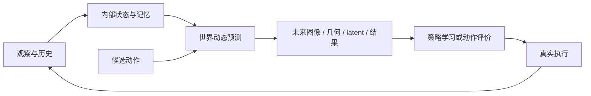
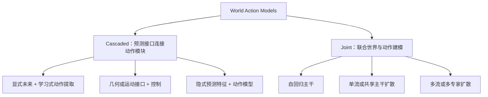

# Awesome World Model

[English](README.md) | **简体中文**

> **综述：世界模型的环境表征、未来预测与具身行动。**
>
> 面向决策的世界模型需要保存任务相关状态、预测动作后果，并让预测参与可执行的行为。

## 目录

- [摘要](#overview)
- [1. 世界模型科普](#primer)
- [2. 世界模型与动作生成](#wam)
- [3. 问题分类与代表工作](#problems)
- [4. 评测基准与实验分析](#evaluation)
- [5. 研究讨论](#discussion)
- [论文与学习资源](#resources)

## 摘要

世界模型通过内部表示和动态预测，描述环境当前处于什么状态、未来可能怎样变化。从 [World Models](https://arxiv.org/abs/1803.10122)与 [Dreamer](https://arxiv.org/abs/1912.01603)的潜空间想象，到视频生成与交互模拟，再到连接未来预测和机器人控制的 [World Action Models](https://arxiv.org/abs/2605.12090)，这些路线共同关注如何让预测成为决策的依据。

机器人操作对世界模型提出了更具体的要求：预测需要响应动作、保持任务状态，并支持控制。**预测什么**与**预测怎样参与动作生成**是两个核心问题。模型能否保持长期状态、正确预测动作后果，并保留决策所需的信息，决定了预测在复杂任务中的作用。

| 主题 | 核心问题 | 专题 |
|---|---|---|
| 01 · 世界模型科普 | 模型表示什么、预测什么、用在哪里？ | [概念、发展脉络与术语](docs/01-world-model-primer.md) |
| 02 · World Action Models | 未来信息如何用于策略、规划和控制？ | [预测目标、模型架构与训练推理](docs/02-world-action-models.md) |
| 03 · 问题分类 | 预测能否保持状态、符合物理规律并帮助决策？ | [代表方法、实验结果与开放问题](docs/03-problem-taxonomy.md) |

[论文索引](docs/paper-index.md)

## 1. 世界模型科普

### 1.1 状态、动作与未来

以机器人推杯子为例：相机给出当前画面，模型需要表示杯子的位置、桌面结构和机器人状态；给定推的方向与幅度，预测杯子接下来怎样移动。这包含两个相互依赖的过程：**从观察形成内部状态，以及根据状态和动作预测变化**。

$$
z_t = E(o_{\le t},a_{<t}),\qquad
\hat z_{t+1} \sim p_\theta(z_{t+1}\mid z_t,a_t).
$$

这里 $o_t$ 是观察，$z_t$ 是内部状态，$a_t$ 是动作。需要可视化时，可以将未来状态解码成图像、视频或几何；用于控制时，也可以直接在 latent 空间规划或训练策略。部分可观测环境需要历史信息或记忆，单帧图像通常不能完整表达速度、遮挡关系和先前交互。

[Dreamer](https://arxiv.org/abs/1912.01603)通过想象轨迹学习行为，[V-JEPA 2](https://arxiv.org/abs/2506.09985)则将表征预测与规划结合，体现了预测模型参与决策的不同路径。

### 1.2 两条主线与四类应用

可以从“理解世界”和“想象未来”两条主线理解世界模型。前者关注状态中保存什么，后者关注状态如何随条件改变；它们可以在同一模型中结合。

| 方向 | 研究内容 | 代表工作 |
|---|---|---|
| 内部表示 | 语义、对象、空间关系、历史与潜在动态 | [World Models](https://arxiv.org/abs/1803.10122)、[I-JEPA](https://arxiv.org/abs/2301.08243) |
| 未来预测 | 给定条件后的视觉、几何、交互与结果 | [Sora 技术报告](https://openai.com/index/video-generation-models-as-world-simulators/)、[Genie 3 研究介绍](https://deepmind.google/blog/genie-3-a-new-frontier-for-world-models/) |
| 游戏智能 | 动作条件场景演化与交互模拟 | [GameNGen](https://arxiv.org/abs/2408.14837) |
| 具身智能 | 视觉计划、策略评估、想象数据与动作生成 | [World Action Models](https://arxiv.org/abs/2605.12090) |
| 城市智能 | 驾驶场景预测、交通交互和决策模拟 | [WorldSimBench](https://arxiv.org/abs/2410.18072)的驾驶场景评测 |
| 社会智能 | 带记忆、反思和计划的多智能体交互 | [Generative Agents](https://arxiv.org/abs/2304.03442) |

这些应用的状态、动作和评测协议不同。社会行为模拟、视频理解与机器人接触动力学应分别评价，不能用一个总分替代。

[世界模型：概念、发展脉络与应用](docs/01-world-model-primer.md)

## 2. 世界模型与动作生成

### 2.1 动作生成与未来预测

普通策略直接建模 $p(a\mid o,\ell)$。动作条件世界模型建模 $p(o'\mid o,a)$。WAM 在学习或推理中把未来状态与动作联系起来，可概括为 $p(o',a\mid o,\ell)$；级联方法常将其实现为先预测未来、再依据未来解码动作。这里 $\ell$ 为语言指令。语言条件的目标视频与给定数值动作后的反事实模拟，提供的是不同能力。[WAM 综述](https://arxiv.org/abs/2605.12090)

### 2.2 世界模型预测什么

| 预测信息 | 对动作的作用 | 代表工作 |
|---|---|---|
| RGB 视频、关键帧、视觉子目标 | 描述目标状态或多阶段计划 | UniPi、Video Language Planning、RoboEnvision |
| 预测性 hidden state、未来 latent | 为动作模型提供动态特征，减少像素解码 | VPP、FLARE、LaWAM |
| 深度、对象状态、2D/3D flow、轨迹 | 表示哪里变化、怎样移动 | Im2Flow2Act、3DFlowAction、RynnWorld-4D |
| 掩码、交互区域、触觉与接触 | 突出行动对象与物理交互 | MVA、Dream-Tac、N₀-TWAM |
| 价值、进度与成功评价 | 比较候选动作、检测偏差 | Cosmos Policy、τ₀-WM、MV-WAM |

几何适合约束位置，运动适合描述轨迹，触觉补充视觉不易观察的接触。预测目标的价值取决于其对任务成功率、泛化和控制稳定性的贡献。

### 2.3 六类模型架构

| 架构 | 代表工作 | 特点与局限 |
|---|---|---|
| 显式未来 + 学习式动作提取 | [UniPi](https://arxiv.org/abs/2302.00111)、[VLP](https://arxiv.org/abs/2310.10625)、[MVA](https://arxiv.org/abs/2607.19343) | 预测结果可视化，动作解码依赖视觉计划的可执行性 |
| 几何或运动接口 | [AVDC](https://arxiv.org/abs/2310.08576)、[Im2Flow2Act](https://arxiv.org/abs/2407.15208)、[Dream2Flow](https://arxiv.org/abs/2512.24766) | 运动可跨本体表达，仍受深度、对应、抓取与控制误差影响 |
| 隐式预测特征 | [ARDuP](https://arxiv.org/abs/2406.13301)、[VPP](https://arxiv.org/abs/2412.14803)、[RynnWorld-4D](https://arxiv.org/abs/2607.06559) | 减少 RGB 解码开销，效果取决于特征保留了多少动作相关信息 |
| Joint 自回归 | [WorldVLA](https://arxiv.org/abs/2506.21539)、[RynnVLA-002](https://arxiv.org/abs/2511.17502) | 统一序列建模；动作编码与生成延迟需单独设计 |
| Joint 单流 / 共享主干扩散 | [UWM](https://arxiv.org/abs/2504.02792)、[FLARE](https://arxiv.org/abs/2505.15659)、[DreamZero](https://arxiv.org/abs/2602.15922) | 共享训练信号；各方法的目标及推理流程不同 |
| Joint 多流 / 多专家扩散 | [Motus](https://arxiv.org/abs/2512.13030)、[LingBot-VA](https://arxiv.org/abs/2601.21998)、[Fast-WAM](https://arxiv.org/abs/2603.16666) | 各模态可独立建模，信息交换方式影响生成一致性与推理成本 |

预测结果的形式、训练目标和推理过程描述了模型的不同方面。Im2Flow2Act 将运动轨迹输入学习式控制策略；FLARE 在 latent 空间使用未来监督；扩散模型也可以按时间顺序逐块预测。联合训练与级联推理可以出现在同一模型中。

显式视觉计划把任务目标转成可查看的未来状态，随后由 IDM 或控制策略执行；几何与运动接口进一步把“物体怎样移动”从外观中分离出来；隐式特征路线则让动作模块直接读取预测性表征。三者的共同问题是：**中间预测所表达的变化，能否可靠地转成机器人动作？**

联合建模将未来与动作放进共享训练过程。[DreamZero](https://arxiv.org/abs/2602.15922)以联合视频动作 flow matching 学习两者，并在执行时用新获取的真实观察更新生成上下文。它展示了世界预测、动作输出和环境反馈如何在同一系统中连接。

*论文图：[DreamZero](https://arxiv.org/abs/2602.15922)。左侧为联合训练，右侧为真实观测反馈下的执行。*

### 2.4 训练时预测未来，推理时如何使用

未来信息可以作为训练监督、部署时的预测特征、显式视频计划或候选动作搜索的依据。[Fast-WAM](https://arxiv.org/abs/2603.16666)在推理期移除未来分支，[LaWAM](https://arxiv.org/abs/2606.15768)预测紧凑子目标，[DreamZero](https://arxiv.org/abs/2602.15922)联合生成未来与动作，形成不同的精度与计算成本取舍。

共享未来监督可能改善动作表征；部署时增加未来生成或候选搜索则会消耗延迟预算。任务成功率、预测开销和真实观察反馈频率共同决定系统的部署表现。

[World Action Models：预测目标、架构与推理](docs/02-world-action-models.md)

## 3. 问题分类与代表工作

架构回答“怎样连接模块”，问题分类回答“这些连接还会在哪里失败”。面向决策，可以从三个相互关联的维度检查世界模型。

| 问题 | 典型问题 | 主要方法 | 代表工作 |
|---|---|---|---|
| 长期状态一致性 | 回访、遮挡或多阶段操作后，身份和状态能否保持？ | 空间记忆、压缩历史、对象状态 | [Spatial Memory](https://arxiv.org/abs/2506.05284)、[RELIC](https://arxiv.org/abs/2512.04040)、[WorldDP](https://arxiv.org/abs/2606.08775) |
| 动作与物理正确性 | 改变动作后，未来是否相应改变？轨迹、关系和控制约束是否合理？ | 逐帧动作注入、结构监督、后训练对齐 | [Ctrl-World](https://arxiv.org/abs/2510.10125)、[PhysisForcing](https://arxiv.org/abs/2606.28128)、[EVA](https://arxiv.org/abs/2603.17808)、[ABot-PhysWorld](https://arxiv.org/abs/2603.23376) |
| 面向动作决策的表征 | 保留的信息是否足以支持当前任务的动作选择？ | 紧凑子目标、动作相关表征对齐 | [LaWAM](https://arxiv.org/abs/2606.15768)、[AGRA](https://arxiv.org/abs/2606.12217) |

[DexWorldModel](https://arxiv.org/abs/2604.16484)将语义 latent、长期记忆与异步推理结合。[WorldDP](https://arxiv.org/abs/2606.08775)通过对象状态支持多阶段规划；长期身份保持和遮挡恢复仍是对象表示面临的独立挑战。

### 3.1 长期状态一致性：让过去的交互继续影响未来

有限视频上下文容易丢失离开视野的对象和已完成的任务状态。[Spatial Memory](https://arxiv.org/abs/2506.05284)保存可检索的空间与历史信息，为回访区域提供参照；[RELIC](https://arxiv.org/abs/2512.04040)通过历史压缩支持流式生成。对机器人而言，还需检验记忆能否更新动态对象，保留关键接触与任务进展。

*论文图：[Video World Models with Long-term Spatial Memory](https://arxiv.org/abs/2506.05284)。空间结构、历史参考帧与近期上下文共同参与预测。*

### 3.2 动作与物理正确性：让未来响应给定动作

[Ctrl-World](https://arxiv.org/abs/2510.10125)强调动作与生成帧的细粒度对应；[PhysisForcing](https://arxiv.org/abs/2606.28128)用轨迹和实体关系监督约束预测；[EVA](https://arxiv.org/abs/2603.17808)与 [ABot-PhysWorld](https://arxiv.org/abs/2603.23376)则通过后训练强化动作可执行性或物理偏好。这些路线针对不同误差，适合按证据层次比较。

| 层次 | 评测内容 | 相关方法 |
|---|---|---|
| 几何连续 | 物体轨迹、结构与遮挡关系一致 | 点轨迹、深度和空间记忆 |
| 交互关系 | 接触对象、作用顺序和结果随动作改变 | 动作条件预测、关系监督、干预测试 |
| 动作可执行性 | 解码动作符合机器人运动与控制限制 | IDM 奖励、约束控制、真实执行 |

视频质量分数、视觉偏好或动作平滑度各自只覆盖部分证据。评测还需要改变动作、打乱时间对应或引入失败轨迹，检查预测是否忠实反映相应后果。

### 3.3 面向动作决策的表征

面向动作决策的表征需要保留足以支持动作选择的信息（Action-Sufficient）。完整未来视频包含大量外观细节，控制可能只需要其中的目标位置、运动方向或接触关系。[LaWAM](https://arxiv.org/abs/2606.15768)预测紧凑 latent 子目标；[AGRA](https://arxiv.org/abs/2606.12217)对齐世界模型与动作解码器之间的特征，使动作模型更关注与任务有关的区域。

*论文图：[Making Foresight Actionable](https://arxiv.org/abs/2606.12217)。视觉教师的空间语义信息用于对齐世界模型中间特征。*

这一方向需要同时回答信息与成本两个问题：紧凑表征是否保留精细操作所需的几何和动态，以及减少未来重建后能否保留控制收益。

[世界模型的关键问题与代表方法](docs/03-problem-taxonomy.md)

## 4. 评测基准与实验分析

| 评测方向 | 基准 | 评测内容 |
|---|---|---|
| 视觉质量与控制效果 | [WorldSimBench](https://arxiv.org/abs/2410.18072) | 生成视频的视觉质量，以及用于机器人控制时的表现 |
| 物理预测 | [Physics-IQ](https://arxiv.org/abs/2501.09038) | 检查特定物理场景的未来演化 |
| 具身视频 | [EWMBench](https://arxiv.org/abs/2505.09694) | 分开评价场景、运动与语义 |
| 视频理解与推理 | [MMWorld](https://arxiv.org/abs/2406.08407) | 跨学科视频问答与推理 |
| 下游操作 | LIBERO、RoboTwin、RoboCasa 与真机任务 | 评价任务成功率、跨场景泛化与执行稳定性 |

视频生成吞吐、动作块预测延迟与机器人控制频率对应不同的计算环节。生成长度、采样步数、硬件和反馈调度会影响速度；本体、训练数据与任务划分则影响成功率与泛化。代表方法的实验结果见[性能与实验设置](docs/03-problem-taxonomy.md#evidence)。

## 5. 研究讨论

- **分层状态**：对象身份与空间结构的长期记忆，如何与短时动作动态协同？
- **任务条件记忆**：哪些事件值得写入，如何结合位置、对象、目标和候选动作检索，以及何时修正旧状态？
- **预测信息与任务的关系**：RGB、几何、运动和交互信息在不同操作任务中是否互补？
- **训练收益与推理成本**：在相同预算下，训练期未来监督、推理期 latent 预测和完整未来 rollout 各有什么优势？

[开放问题](docs/03-problem-taxonomy.md#discussion)

## 论文与学习资源

- [论文索引](docs/paper-index.md)
- [CVPR 2025 Tutorial: From Video Generation to World Model](https://world-model-tutorial.github.io/)：从视频生成进入世界模型研究。
- [Awesome Closed-Loop VLA](https://github.com/ZJU-OmniAI/Awesome-Closed-Loop-VLA/blob/main/README_zh.md)：机器人执行、预测与学习闭环。
- [论文图示与出处](assets/figures/README.md)

社区交流

