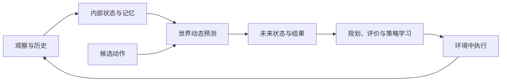
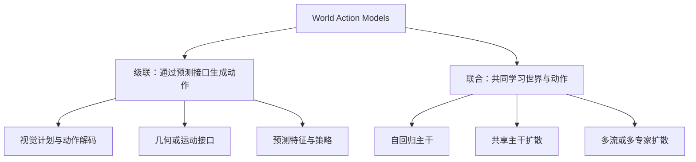

# Awesome World Model

[English](README.md) | **简体中文**

> **世界模型：从环境表征、未来预测到具身行动。**
>
> 理解当前状态，预测动作后果，让想象中的未来参与真实世界的决策。

世界模型学习环境的内部表示及其变化规律，连接视觉理解、视频生成、模型式强化学习与机器人控制。面向具身智能，研究重点进一步落在三个问题上：**模型预测什么，预测如何用于动作生成，以及预测能否在长期交互中保持可靠。**

[论文索引](docs/paper-index.md) · [世界模型基础](docs/01-world-model-primer.md) · [World Action Models](docs/02-world-action-models.md) · [关键问题与代表方法](docs/03-problem-taxonomy.md)

## 目录

- [1. 世界模型科普](#primer)
- [2. World Action Models：从预测到动作](#wam)
- [3. 问题分类与代表工作](#problems)
- [4. 评测基准与实验结果](#evaluation)
- [5. 开放问题](#discussion)
- [6. 论文与学习资源](#resources)

## 1. 世界模型科普

### 1.1 状态表示与动态预测

机器人要把杯子推到桌面另一侧。当前图像呈现杯子的外观与位置，但速度、接触状态和被遮挡的部分，往往需要结合历史观察才能判断。世界模型首先形成内部状态，再预测候选动作将怎样改变杯子与周围环境。

$$
z_t = E(o_{\le t},a_{\lt t}),\qquad
\hat z_{t+1} \sim p_\theta(z_{t+1}\mid z_t,a_t).
$$

这里 $o_t$ 为观察，$z_t$ 为内部状态，$a_t$ 为动作。状态可以采用潜在特征、对象集合、三维结构或记忆；未来状态可以解码为图像和视频，也可以直接用于规划或策略学习。[World Models](https://arxiv.org/abs/1803.10122) 将视觉压缩、时序动态与控制结合；[Dreamer](https://arxiv.org/abs/1912.01603) 进一步利用潜空间中的想象轨迹训练策略与价值模型。

世界模型与决策的联系可以发生在不同阶段：训练时生成想象轨迹，推理时比较候选动作，或向动作模型提供未来特征。预测范围、状态表示和使用方式，共同决定模型需要学习哪些环境规律。

### 1.2 从潜空间动态到交互世界

| 日期 | 工作 | 主要贡献 |
|---|---|---|
| 2018-03-27 | [World Models](https://arxiv.org/abs/1803.10122) | 通过视觉压缩与时序动态构建世界表示，研究在想象环境中学习控制 |
| 2019-12-03 | [Dreamer](https://arxiv.org/abs/1912.01603) | 从潜空间想象轨迹学习策略与价值 |
| 2023-01-10 | [DreamerV3](https://arxiv.org/abs/2301.04104) | 用统一配置在多类任务中学习世界模型与行为 |
| 2023-01-19 | [I-JEPA](https://arxiv.org/abs/2301.08243) | 通过预测图像区域的表征学习视觉特征 |
| 2024-08-27 | [GameNGen](https://arxiv.org/abs/2408.14837) | 以动作条件视频生成模拟 DOOM 游戏的交互变化 |
| 2025-06-11 | [V-JEPA 2](https://arxiv.org/abs/2506.09985) | 将视频表征学习、未来预测与机器人规划连接起来 |

这些工作发展出不同的预测目标：Dreamer 在潜空间学习动态，I-JEPA 预测图像区域表征，GameNGen 生成动作条件下的后续画面。I-JEPA 提供的是视觉表征学习方法；时间与动作条件则使预测进一步具备描述交互过程的能力。

视频生成扩展了世界模型能够表达的场景与变化。[Sora](https://openai.com/index/video-generation-models-as-world-simulators/) 探索视频模型的模拟能力，[Genie 3](https://deepmind.google/blog/genie-3-a-new-frontier-for-world-models/) 则面向可交互的世界生成。用于控制时，模型还需要保持状态，并准确响应具体动作。

### 1.3 主要应用

| 应用 | 建模对象 | 代表工作 |
|---|---|---|
| 游戏与交互环境 | 控制输入引起的场景与角色状态变化 | [GameNGen](https://arxiv.org/abs/2408.14837) |
| 机器人操作 | 对象运动、接触、视觉计划与机器人动作 | [World Action Models](https://arxiv.org/abs/2605.12090) |
| 驾驶与交通场景 | 道路参与者、运动轨迹与驾驶决策后果 | [WorldSimBench](https://arxiv.org/abs/2410.18072) |
| 社会行为模拟 | 个体记忆、计划与多智能体交互 | [Generative Agents](https://arxiv.org/abs/2304.03442) |
| 网页智能体 | 网页状态与候选操作的结果 | [WebDreamer](https://arxiv.org/abs/2411.06559) |

不同应用赋予“状态”和“动作”不同的含义。机器人操作尤其依赖对象几何、接触动态与本体约束，世界预测需要进一步连接到可执行的控制。

## 2. World Action Models：从预测到动作

### 2.1 世界模型与动作模型怎样连接

World Action Models（WAM）将预测性世界建模与动作生成结合。VLA 策略根据观察和指令输出动作；动作条件世界模型预测给定动作的后果；目标条件视觉规划则生成与任务对应的未来状态。[World Action Models: The Next Frontier in Embodied AI](https://arxiv.org/abs/2605.12090)

| 模型 | 建模形式 | 作用 |
|---|---|---|
| VLA 策略 | $p(a\mid o,\ell)$ | 根据观察与指令生成动作 |
| 动作条件世界模型 | $p(o'\mid o,a)$ | 预测给定动作产生的未来观察 |
| 目标条件视觉规划 | $p(o'\mid o,\ell)$ | 生成任务对应的视觉计划或子目标 |
| 级联 WAM | $p(o'\mid o,\ell)\,p(a\mid o',o,\ell)$ | 先预测未来，再从未来提取动作 |
| 联合 WAM | $p(o',a\mid o,\ell)$ | 共同学习未来观察与动作 |

其中 $o$ 为当前观察，$o'$ 为未来观察，$a$ 为动作，$\ell$ 为语言指令；模型还可以使用历史与机器人本体状态。未来也可以表示为潜在特征或运动轨迹，而无需生成完整 RGB 视频。

### 2.2 预测什么信息

| 预测目标 | 对动作生成的作用 | 代表工作 |
|---|---|---|
| 视频、关键帧与视觉子目标 | 描述目标状态，分解长程任务 | [UniPi](https://arxiv.org/abs/2302.00111)、[VLP](https://arxiv.org/abs/2310.10625)、[RoboEnvision](https://arxiv.org/abs/2506.22007) |
| 预测性特征与未来表征 | 为策略提供动态信息，减少像素重建开销 | [VPP](https://arxiv.org/abs/2412.14803)、[FLARE](https://arxiv.org/abs/2505.15659)、[LaWAM](https://arxiv.org/abs/2606.15768) |
| 几何、光流与对象轨迹 | 表达对象在哪里、应该怎样移动 | [Im2Flow2Act](https://arxiv.org/abs/2407.15208)、[3DFlowAction](https://arxiv.org/abs/2506.06199)、[RynnWorld-4D](https://arxiv.org/abs/2607.06559) |
| 触觉与接触状态 | 补充视觉难以直接观察的物理交互 | [Dream-Tac](https://arxiv.org/abs/2606.08737)、[N₀-TWAM](https://arxiv.org/abs/2607.23783) |
| 价值、进度与任务结果 | 评价候选动作，检测偏差并支持恢复 | [Cosmos Policy](https://arxiv.org/abs/2601.16163)、[τ₀-WM](https://arxiv.org/abs/2606.01027)、[MV-WAM](https://arxiv.org/abs/2606.21088) |

预测目标决定动作模块能够获得的信息。对象轨迹便于表达运动意图，触觉有助于描述接触，潜在特征则减少完整视频生成的负担。它们对抓取、移动、放置和精细插入的作用，取决于任务所需的几何与动态信息。

### 2.3 级联与联合建模

| 架构 | 预测与动作的连接方式 | 代表工作 |
|---|---|---|
| 级联：视觉计划 | 先生成未来画面，再由逆动力学模型或策略解码动作 | [UniPi](https://arxiv.org/abs/2302.00111)、[VLP](https://arxiv.org/abs/2310.10625)、[MVA](https://arxiv.org/abs/2607.19343) |
| 级联：几何与运动 | 预测对象运动，结合学习式策略、运动学或轨迹优化控制机器人 | [AVDC](https://arxiv.org/abs/2310.08576)、[Im2Flow2Act](https://arxiv.org/abs/2407.15208)、[Dream2Flow](https://arxiv.org/abs/2512.24766) |
| 级联：预测特征 | 将未来潜在特征或预测性中间特征输入动作模型 | [ARDuP](https://arxiv.org/abs/2406.13301)、[VPP](https://arxiv.org/abs/2412.14803)、[RynnWorld-4D](https://arxiv.org/abs/2607.06559) |
| 联合：自回归主干 | 世界预测与动作生成共享多模态序列模型 | [WorldVLA](https://arxiv.org/abs/2506.21539)、[RynnVLA-002](https://arxiv.org/abs/2511.17502) |
| 联合：共享主干扩散 | 在共享模型中学习未来与动作目标 | [UWM](https://arxiv.org/abs/2504.02792)、[FLARE](https://arxiv.org/abs/2505.15659)、[DreamZero](https://arxiv.org/abs/2602.15922) |
| 联合：多流或多专家扩散 | 为不同模态保留分支，通过跨分支交互交换信息 | [Motus](https://arxiv.org/abs/2512.13030)、[LingBot-VA](https://arxiv.org/abs/2601.21998)、[Fast-WAM](https://arxiv.org/abs/2603.16666) |

**视觉计划与运动接口。** UniPi 用视觉未来表达任务，再通过逆动力学模型推断动作。Im2Flow2Act 将对象运动轨迹交给学习式控制策略，Dream2Flow 则从生成视频中恢复三维对象流并优化机器人动作。这类接口便于查看计划，也需要解决视觉目标与机器人运动、抓取和接触之间的对应关系。

**预测特征与动作策略。** VPP 读取视频模型中间层的预测性视觉特征，RynnWorld-4D 将 RGB、深度与光流的动态建模用于策略学习。省去完整视频解码后，动作模型仍需要从特征中获得对象变化、空间关系和交互信息。

**联合世界与动作生成。** WorldVLA 共享动作模式与世界预测模式；UWM 通过模态的条件与生成状态支持策略、前向动态和逆动力学等任务；DreamZero 使用联合视频动作 flow matching，并在执行中用真实观察更新生成上下文。联合训练可以共享动态信息，部署时如何生成动作则由具体模型决定。

*图：[DreamZero](https://arxiv.org/abs/2602.15922)。联合训练未来视频与动作，执行时通过真实观察更新上下文。*

### 2.4 训练时预测，部署时怎样使用

| 工作 | 未来信息参与训练的方式 | 部署时使用的信息 |
|---|---|---|
| [WorldVLA](https://arxiv.org/abs/2506.21539) | 动作生成与世界预测共享主干 | 动作模式直接生成动作 |
| [Fast-WAM](https://arxiv.org/abs/2603.16666) | 联合未来预测与动作学习，限制动作分支的可见信息 | 当前帧世界特征与动作分支；移除未来分支 |
| [LaWAM](https://arxiv.org/abs/2606.15768) | 学习潜在动作及未来特征预测 | 当前特征与预测的潜在子目标 |
| [DreamZero](https://arxiv.org/abs/2602.15922) | 联合视频动作生成 | 联合预测过程与不断更新的真实观察 |
| [Cosmos Policy](https://arxiv.org/abs/2601.16163) | 将动作、状态与价值编码进视频潜在序列 | 控制或规划所需的条件生成 |

训练期的未来监督可以改善动作表征，部署期的未来生成则引入额外计算。Fast-WAM 通过注意力结构约束训练中可用的信息，使推理能够移除未来分支；LaWAM 保留紧凑的未来特征；DreamZero 将视频与动作共同生成。它们分别探索了未来信息与推理成本之间的不同取舍。

[World Action Models：方法与架构](docs/02-world-action-models.md)

## 3. 问题分类与代表工作

长期交互要求模型保存已经发生的变化，预测具体动作的后果，并向策略提供与任务有关的信息。记忆、物理动态与动作表征共同影响世界模型在决策中的可靠性。

| 研究问题 | 典型困难 | 主要方法 |
|---|---|---|
| 长期状态一致性 | 回访时场景变化、遮挡后对象丢失、多阶段任务状态遗忘 | 空间记忆、历史压缩、对象中心状态 |
| 动作与物理正确性 | 预测忽略动作、轨迹变形、接触关系错误 | 精细动作对齐、结构监督、后训练 |
| 面向动作决策的表征 | 预测画面合理，策略却丢失关键几何或关注无关背景 | 潜在子目标、动作相关特征对齐 |

### 3.1 长期状态一致性

**空间与情景记忆。** [Video World Models with Long-term Spatial Memory](https://arxiv.org/abs/2506.05284) 在线保存几何结构与历史参考帧，为回访区域提供空间与视觉参照。近期观察描述当前变化，长期记忆保留有限视频上下文之外的环境信息。

*图：[Video World Models with Long-term Spatial Memory](https://arxiv.org/abs/2506.05284)。空间记忆与历史检索共同支撑长期预测。*

**压缩历史与流式生成。** [RELIC](https://arxiv.org/abs/2512.04040) 将历史压缩为潜在 token，并结合动作与相机位姿信息支持因果流式生成。[DexWorldModel](https://arxiv.org/abs/2604.16484) 则结合语义状态、TTT Memory 与异步推理，减少随历史增长的存储和串行计算开销。

**对象状态与多阶段规划。** [WorldDP](https://arxiv.org/abs/2606.08775) 在对象中心状态上学习动态，高层规划子目标，低层使用 Diffusion Policy 执行。多阶段规划依赖正确的对象状态；更长时间的交互还要求持续维护对象身份、遮挡后的状态及已经完成的任务。

空间记忆适合保存布局，压缩记忆控制历史开销，对象表示便于规划。动态环境仍需要解决旧状态何时失效，以及接触、移动和任务进展怎样写入记忆。

### 3.2 动作与物理正确性

**精细动作条件。** [Ctrl-World](https://arxiv.org/abs/2510.10125) 将逐帧动作条件、多视角预测与历史检索结合，使生成环境能够响应机器人控制并支持策略评估。动作与预测帧之间的时间对应，决定了模型能否区分方向、幅度与执行顺序不同的操作。

**结构监督。** [PhysisForcing](https://arxiv.org/abs/2606.28128) 用点轨迹约束局部运动，用实体关系监督交互结构，将训练重点放到对象运动与相互作用上。

*图：[PhysisForcing](https://arxiv.org/abs/2606.28128)。局部轨迹与实体关系分别约束运动和交互结构。*

**后训练。** [EVA](https://arxiv.org/abs/2603.17808) 使用逆动力学模型将视频解码为动作，以速度、加速度和本体限制等构造奖励；[ABot-PhysWorld](https://arxiv.org/abs/2603.23376) 分别评价物理合理性与动作一致性，并进行偏好优化。两者将控制约束或物理评价反馈到生成模型，但效果仍受动作解码器、评价模型与训练数据覆盖的影响。

几何连续性、接触关系与动作可执行性分别对应不同的约束。改变动作、反转轨迹或引入失败操作，可以检验模型是否真正预测了这些变化的后果。

### 3.3 面向动作决策的表征

**紧凑的未来子目标。** [LaWAM](https://arxiv.org/abs/2606.15768) 在视觉特征空间学习潜在动作与未来预测，让动作模块同时读取当前特征和预测子目标。模型减少外观重建的同时，需要保留精细操作所需的几何和动态。

**世界特征与动作解码的对齐。** [AGRA](https://arxiv.org/abs/2606.12217) 研究视频生成特征与动作头之间的联系，利用视觉教师的空间语义信息对齐世界模型中间特征，改善动作相关区域的表示。

*图：[Making Foresight Actionable](https://arxiv.org/abs/2606.12217)。视觉教师引导世界模型的空间语义特征，用于动作解码。*

面向动作的预测需要保留能够区分操作后果的信息。对象位置、运动方向和接触状态的价值，取决于任务对精度、泛化与实时性的要求。

[关键问题、方法细节与实验分析](docs/03-problem-taxonomy.md)

## 4. 评测基准与实验结果

### 4.1 评测什么能力

| 方向 | 基准或任务 | 评测内容 |
|---|---|---|
| 视觉质量与控制效果 | [WorldSimBench](https://arxiv.org/abs/2410.18072) | 感知质量，以及世界预测参与决策时的效果 |
| 物理预测 | [Physics-IQ](https://arxiv.org/abs/2501.09038) | 特定物理场景中未来演化的正确性 |
| 具身视频生成 | [EWMBench](https://arxiv.org/abs/2505.09694) | 场景、运动与语义质量 |
| 视频理解与推理 | [MMWorld](https://arxiv.org/abs/2406.08407) | 跨学科视频问答与推理 |
| 机器人操作 | LIBERO、RoboTwin、RoboCasa 与真机任务 | 任务成功率、跨场景泛化与执行稳定性 |

预测质量、任务成功率与运行效率对应不同能力。长期预测需要关注状态漂移，动作条件模型需要关注对控制变化的响应，策略则需要在完整任务中验证预测带来的收益。

### 4.2 代表实验

| 工作 | 实验设置 | 结果 |
|---|---|---|
| [WorldDP](https://arxiv.org/html/2606.08775v1) | Cube-Triple；完成全部三个方块的操作 | 成功率 30%，对比 HECRL* 的 12% |
| [EVA](https://arxiv.org/html/2603.17808v1) | 真机 Seen / OOD 各 5 个任务，每任务 20 次；比较加入 RL 前后 | Seen：52% → 64%；OOD：42% → 60% |
| [AGRA](https://arxiv.org/html/2606.12217v1) | RoboCasa GR1，10% 训练数据，Unseen Combinations | WAM：59.57%；AGRA-ActionCondPass：66.28% |
| [RELIC](https://arxiv.org/html/2512.04040v1) | 14B 模型，4 × H100 | 视频生成吞吐 16 FPS |

视频生成吞吐、动作块预测延迟与机器人控制频率属于不同环节。例如，[LaWAM](https://arxiv.org/html/2606.15768v2) 的 187 ms/action chunk 使用 A100、BF16 和 10 步动作去噪，计时范围为模型计算。部署中的观察更新、动作执行和异步调度，还会影响端到端响应速度。

[更多实验结果与设置](docs/03-problem-taxonomy.md#evidence)

## 5. 开放问题

- **长期状态与短时动态如何协同？** 对象身份和空间布局需要长期保持，接触与运动状态需要快速更新。分层状态能否同时改善回访一致性与精细控制？
- **记忆应保存和检索什么？** 关键接触、对象移动和任务阶段转换具有不同的信息价值。任务、位置与候选动作如何共同决定记忆的写入、检索和修正？
- **物理预测如何反映真实控制能力？** 轨迹、关系与动作约束的改善，能否稳定转化为任务成功率？失败轨迹和分布外动作如何参与训练与评价？
- **怎样在固定计算预算下选择预测目标？** RGB、潜在特征、几何与触觉在不同任务中各有作用。训练期未来监督、部署期子目标预测与多步想象，应如何分配计算资源？

## 6. 论文与学习资源

| 主题 | 论文 |
|---|---|
| 世界模型基础 | [基础研究](docs/paper-index.md#foundations) · [综述](docs/paper-index.md#surveys) |
| 预测与动作生成 | [视觉规划](docs/paper-index.md#wam-visual-planning) · [几何与运动](docs/paper-index.md#wam-geometry-motion) · [预测表征](docs/paper-index.md#wam-representation) · [联合建模](docs/paper-index.md#wam-joint) |
| 决策与部署 | [价值与反馈](docs/paper-index.md#wam-feedback) · [触觉与接触](docs/paper-index.md#wam-tactile) · [高效推理](docs/paper-index.md#wam-efficiency) |
| 关键问题与评测 | [状态与记忆](docs/paper-index.md#problem-memory) · [动作与物理](docs/paper-index.md#problem-physics) · [评测基准](docs/paper-index.md#benchmarks) |

[CVPR 2025 Tutorial: From Video Generation to World Model](https://world-model-tutorial.github.io/)

社区交流

