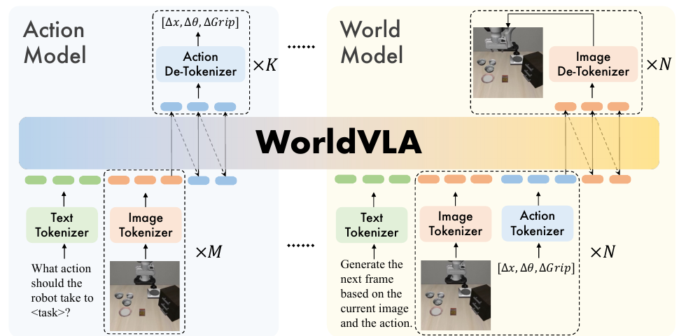
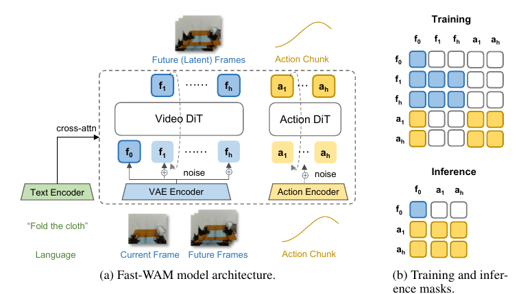

# 02 · 世界模型与动作生成

[上一篇：科普](01-world-model-primer.md) · [返回总览](../README_cn.md) · [下一篇：问题分类](03-problem-taxonomy.md) · [论文索引](paper-index.md)

World Action Models 将预测性世界建模与动作生成连接起来。预测目标决定动作模块可获得哪些未来信息，模块间的信息流和训练目标则决定这些信息如何参与控制。

## 1. 模型定义与分类

| 模型 | 概率形式 | 作用 |
|---|---|---|
| VLA 策略 | $p(a\mid o,\ell)$ | 由当前观察与语言生成动作 |
| 动作条件世界模型 | $p(o'\mid o,a)$ | 预测执行给定动作后的观察 |
| 目标条件视觉规划 | $p(o'\mid o,\ell)$ | 生成任务条件的未来或子目标 |
| 级联 WAM | $p(o'\mid o,\ell)\,p(a\mid o',o,\ell)$ | 先预测未来状态，再根据预测生成动作 |
| 联合 WAM | $p(o',a\mid o,\ell)$ | 在模型中共同学习未来与动作 |

其中 $o$ 表示观察，$a$ 表示动作，$\ell$ 表示语言指令，$o'$ 表示未来观察。完整条件还可以包含历史和机器人本体状态。分布分解、训练目标与推理信息流分别描述模型的不同层面。[World Action Models: The Next Frontier in Embodied AI](https://arxiv.org/abs/2605.12090)

WAM 的主要架构特点包括：

- **显式 / 隐式**描述控制接口是否以可查看的未来图像、几何或运动呈现。训练中出现 RGB 损失，并不意味着部署必须生成 RGB。
- **级联 / 联合**分别涉及推理信息流与训练方式。有独立动作头的系统，也可能将动作梯度传回世界模型。
- **自回归 / 扩散**描述不同层面的建模过程。扩散模型可以在每个动作块内部去噪，在块之间自回归展开。
- **单流 / 多流**是主干与模态交互的组织方式，不直接决定是否闭环、是否支持连续动作或是否实时。

## 2. 预测目标与动作生成

| 信息类型 | 预测目标 | 用于动作生成的方式 | 主要挑战 |
|---|---|---|---|
| 外观 | RGB、未来视频、关键帧 | IDM、目标条件策略、视频条件策略 | 视觉计划是否对应可执行动作 |
| 表征 | 未来语义 latent、hidden state | 作为动作扩散模型的输入，或用于表征对齐 | 特征能否捕捉交互过程，避免依赖无关背景 |
| 几何 | 深度、对象 pose、三维结构 | 轨迹优化或几何特征条件化 | 估计误差、坐标系与尺度 |
| 运动 | 2D/3D flow、点轨迹、SE(3) 变换 | 几何控制或 flow 条件策略 | 对象运动与机器人运动如何对应 |
| 交互 | mask、活动区域、触觉与接触 | 局部特征引导、跨模态融合 | 接触信息是否真实可观测、能否泛化 |
| 结果 | 进度、成功、reward / value | 排序候选、规划、偏差检测 | 评价信号是否校准、是否泛化 |

预测目标还可以扩展到表面法线、点图、占据、可供性、接触图、目标掩码或不确定性。选择时应先明确任务缺少什么信息，再通过受控消融判断额外目标是否改善动作，而不是仅增加预测模态。

## 3. 级联：显式未来与学习式动作提取

共同路径是先得到视觉计划，再由学习模块转成动作。它把长程目标表达与低层控制连接起来，但视觉生成与控制解码的误差会串联。

| 工作 | 世界模型提供什么 | 怎样生成动作 |
|---|---|---|
| [UniPi](https://arxiv.org/abs/2302.00111) | 文本条件未来帧，以及时间细化后的视觉计划 | IDM 由视觉变化回归动作 |
| [Video Language Planning](https://arxiv.org/abs/2310.10625) | 语言子任务与视频展开组成的候选树 | 价值判断选择计划，再由执行模块控制 |
| [RoboEnvision](https://arxiv.org/abs/2506.22007) | 长程任务对应的关键状态与视频计划 | 动作模型连接视觉子目标 |
| [Say, Dream, and Act](https://arxiv.org/abs/2602.10717) | 提前生成的未来视频上下文 | 动作模型结合想象未来与更新的真实观察 |
| [MVA](https://arxiv.org/abs/2607.19343) | 由机器人或物体部分轨迹构成的像素级控制接口 | 逆向模式推断机器人运动，再由 IDM 转为数值动作 |

UniPi 使用学习式时间细化生成更细粒度的视觉计划。VLP 的视频承担搜索中的动态展开，语言模型参与候选提议和价值判断。Say, Dream, and Act 将预先想象的未来上下文与执行时的真实观察结合，支持持续的环境反馈。

MVA 通过部分可见的运动条件切换建模方向：给定机器人运动时预测场景响应，给定目标物体运动时反推机器人行为；生成的视觉行为再经 IDM 转为数值动作。

**讨论**：可查看的计划便于诊断和模块替换；视觉计划与机器人动作空间的一致性、IDM 泛化及生成延迟共同限制执行性能。

## 4. 级联：几何与运动接口

这一组方法以几何或运动作为预测到控制的中间接口。最终控制器可以采用学习式策略，也可以结合运动学与轨迹优化。

| 工作 | 预测结果 | 控制方法 |
|---|---|---|
| [AVDC](https://arxiv.org/abs/2310.08576) | 预测视频的稠密对应与深度 | 估计三维变换并进行几何控制 |
| [Im2Flow2Act](https://arxiv.org/abs/2407.15208) | 根据任务预测的对象 flow / 点轨迹 | 以 flow 为条件的学习式策略 |
| [3DFlowAction](https://arxiv.org/abs/2506.06199) | 对象的三维运动流 | 结合抓取、约束优化和机器人运动学 |
| [Dream2Flow](https://arxiv.org/abs/2512.24766) | 从生成视频恢复的三维对象流 | 对象轨迹跟踪与机器人动作优化 |

光流描述像素对应点在图像间的位移；加入深度和相机几何后，才能将其提升到三维运动。对象流描述物体应该怎样移动，机器人仍需解决怎样抓取、接触和施力。

Im2Flow2Act 的 flow 生成器学习对象运动，flow 条件策略学习机器人控制，从而将对象运动规律与机器人特定的控制映射分开。

**讨论**：对象运动接口便于跨机器人共享，误差来源则扩展到深度、追踪、坐标变换、抓取与轨迹优化。运动学可达性与接触动力学可行性构成不同的执行约束。

## 5. 级联：隐式预测特征与动作模型

这组方法让动作模块读取未来 latent 或预测性 hidden state，减少完整视频重建的开销。预测特征可以直接条件化动作生成，也可以为显式动作搜索提供状态表示。

| 工作 | 预测信息 | 动作生成 |
|---|---|---|
| [ARDuP](https://arxiv.org/abs/2406.13301) | 活动区域约束的未来视频 latent | latent IDM |
| [VPP](https://arxiv.org/abs/2412.14803) | 视频模型中间层的预测性视觉特征 | 聚合特征后作为动作模型的输入 |
| [mimic-video](https://arxiv.org/abs/2512.15692) | 视频动态表征 | 结合上下文的连续控制解码 |
| [RynnWorld-4D](https://arxiv.org/abs/2607.06559) | RGB、深度与光流联合建模得到的内部表征 | 策略读取四维动态特征 |

RynnWorld-4D 通过多个模态分支学习世界动态，再将内部表征交给策略。世界模型内部的多模态组织与世界、动作联合生成的多流架构承担不同职责。

**讨论**：省去 RGB 解码可以减少重建开销，但控制收益依赖于 hidden state 中的任务相关动态。静态视觉特征、预测特征与打乱未来监督之间的消融，有助于区分表征容量与动态信息的贡献。

## 6. 联合：自回归主干

| 工作 | 建模对象 | 动作生成 |
|---|---|---|
| [WorldVLA](https://arxiv.org/abs/2506.21539) | 图像、文本、动作理解与生成 | 动作模式和世界预测模式共享模型；执行不必先生成未来图像 |
| [RynnVLA-002](https://arxiv.org/abs/2511.17502) | VLA 与世界模型联合学习，扩展动作生成设计 | 世界预测与动作生成共享表征 |

*论文图：[WorldVLA](https://arxiv.org/abs/2506.21539)。动作模式与世界预测模式共享主干。*

统一序列连接语言、视觉与动作目标；动作输出形式与推理路径仍由具体模型设计决定。WorldVLA 的动作模式可直接生成动作，世界预测模式则预测给定动作后的图像。

## 7. 联合：单流或共享主干扩散

| 工作 | 主要方法 | 建模能力 |
|---|---|---|
| [UWM](https://arxiv.org/abs/2504.02792) | 视频与动作使用独立噪声时间步 | 模态的条件 / 生成状态决定当前建模模式 |
| [FLARE](https://arxiv.org/abs/2505.15659) | 动作主干的未来 token 与目标 latent 对齐 | 未来表征监督与完整视频生成不同 |
| [Cosmos Policy](https://arxiv.org/abs/2601.16163) | 将动作、本体状态、未来状态与值编码进视频 latent 序列 | 统一生成接口可服务控制，也可服务规划 |
| [DreamZero](https://arxiv.org/abs/2602.15922) | 联合视频动作 flow matching，因果分块生成 | 同一次联合预测与闭环真实观察更新 |

UWM 的概念模式可以按哪些变量已知来理解：

| 模式 | 已知条件 | 生成变量 |
|---|---|---|
| Policy | 当前观察 | 动作 |
| Video prediction | 当前观察 | 未来观察 |
| Forward dynamics | 当前观察、动作 | 未来观察 |
| Inverse dynamics | 当前观察、未来观察 | 动作 |

在 [UWM](https://arxiv.org/abs/2504.02792)中，已知模态作为干净条件，待生成模态逐步去噪；未作为条件或生成目标的模态可保持噪声状态。独立噪声时间步使同一模型支持不同的条件生成任务。

FLARE 以未来 latent 对齐增强动作策略；[DreamZero](../README_cn.md#wam)则在联合视频动作生成过程中结合真实观察反馈。前者侧重预测性表征监督，后者显式建模未来观察与动作的联合分布。

## 8. 联合：多流与多专家扩散

| 工作 | 模型结构 | 训练与推理 |
|---|---|---|
| [Motus](https://arxiv.org/abs/2512.13030) | 理解、视频、动作专家通过 MoT 交互 | 联合调度支持多种条件生成模式 |
| [MotuBrain](https://arxiv.org/abs/2604.27792) | 语言、视频、动作三流，H-Bridge 组织交互 | 多视角、跨本体与高效控制设计 |
| [LingBot-VA](https://arxiv.org/abs/2601.21998) | 视频与动作专家按因果序列生成 | 联合训练，执行中用真实观察校正 |
| [Fast-WAM](https://arxiv.org/abs/2603.16666) | 视频 DiT 与动作 DiT 通过结构化注意力相连 | 未来建模参与训练，推理移除未来分支 |

*论文图：[Fast-WAM](https://arxiv.org/abs/2603.16666)。注意力结构区分了训练时未来监督与推理时可用信息。*

训练时，动作分支只能使用推理时同样能获得的信息。Fast-WAM 通过结构化注意力实现这一限制，在推理时移除未来分支，仅保留当前帧世界特征与动作分支。

## 9. 主要研究方向

几何、语义、接触和价值信号为 WAM 提供了不同的预测目标，形成跨越架构类型的研究方向。

| 研究问题 | 相关工作 |
|---|---|
| 视觉计划怎样帮助 VLA？ | [Veo-Act](paper-index.md#paper-2604.04502)、[MVA](paper-index.md#paper-2607.19343) |
| 几何与运动是否可成为更直接的接口？ | [RoboFlow4D](paper-index.md#paper-2605.17522)、[Geometric Action Model](paper-index.md#paper-2606.17046)、[RynnWorld-4D](paper-index.md#paper-2607.06559)、[FlowWAM](paper-index.md#paper-2607.13017) |
| 如何保留动作相关信息并减少未来生成成本？ | [Being-H0.7](paper-index.md#paper-2605.00078)、[GeoSem-WAM](paper-index.md#paper-2606.03188)、[AGRA](paper-index.md#paper-2606.12217)、[LaWAM](paper-index.md#paper-2606.15768)、[ImageWAM](paper-index.md#paper-2606.19531)、[Bridge-WA](paper-index.md#paper-2607.02195) |
| 如何组织语言、对象与因果序列？ | [OA-WAM](paper-index.md#paper-2605.06481)、[WLA-0](paper-index.md#paper-2606.05979) |
| 如何设计世界、动作与评价的联合模型？ | [MotuBrain](paper-index.md#paper-2604.27792)、[τ₀-WM](paper-index.md#paper-2606.01027)、[RepWAM](paper-index.md#paper-2606.13674)、[MV-WAM](paper-index.md#paper-2606.21088)、[WAM4D](paper-index.md#paper-2606.14048)、[LingBot-VA 2.0](paper-index.md#paper-2607.08639) |
| 如何减少潜空间预测和动作生成的开销？ | [SG-WAM](paper-index.md#paper-2608.01397)、[LiLa-WAM](paper-index.md#paper-2608.03701)、[SelfWAM](paper-index.md#paper-2608.00725)、[Faster-WAM](paper-index.md#paper-2608.02365) |
| 接触和触觉怎样进入预测？ | [Dream-Tac](paper-index.md#paper-2606.08737)、[N₀-TWAM](paper-index.md#paper-2607.23783) |

AGRA 使用联合训练的双 DiT，通过表征对齐改善世界特征到动作解码器的接口质量；LaWAM 以紧凑子目标连接未来预测和动作生成。两者都关注预测对动作的有效性，但采用不同的表征与计算路径。

## 10. 训练与推理

| 方法 | 训练目标 | 推理时使用的信息 | 主要挑战 |
|---|---|---|---|
| UniPi 等视觉规划 | 未来视频与动作解码数据 | 生成的视觉计划 | 生成时间和计划可执行性 |
| VPP 等预测特征策略 | 视频预训练 / 动作监督 | 视频模型内部特征 | 特征是否需要完整去噪、是否包含动态 |
| FLARE | 未来 latent 对齐与动作目标 | 当前输入与策略特征 | 未来监督的效果与训练推理一致性 |
| DreamZero / LingBot-VA | 视频和动作联合目标 | 联合生成过程及真实观察反馈 | 缓存更新、执行前缀和闭环延迟 |
| Fast-WAM | 未来视频与动作联合目标 | 当前帧世界特征与动作分支 | 训练和推理时可用信息的一致性 |
| LaWAM | latent 动态与控制目标 | 预测 latent 子目标 | 精度收益是否抵消预测成本 |

## 11. 架构比较与开放问题

各路线的优势与代价需要结合具体任务判断：显式接口可解释，但存在中间瓶颈；联合主干可共享监督，但要处理模态竞争；多专家能分工，但增加交互与部署设计；latent 路径减少重建负担，但可能损失精细几何。

不同预测模态在抓取、移动、放置和精细插入中的互补性仍是[开放问题](03-problem-taxonomy.md#discussion)。长期交互要求模型保持状态一致、正确预测动作后果，并保留决策所需的信息。
